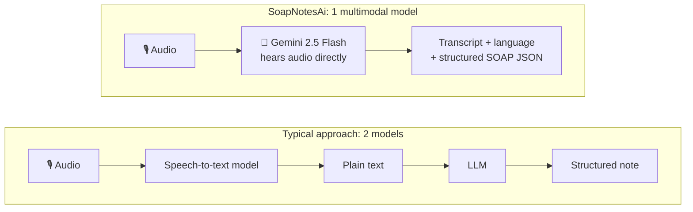
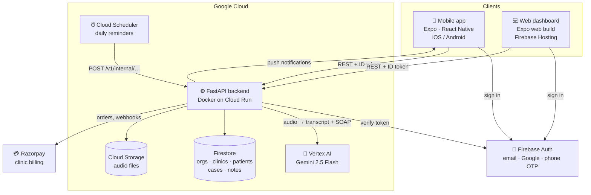
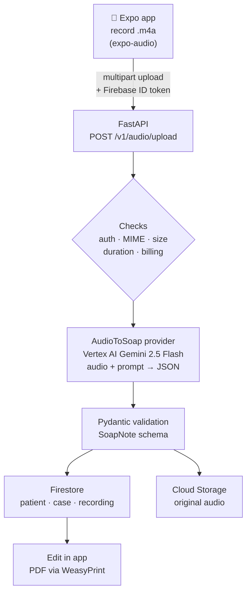

# SoapNotesAi

AI-native, voice-to-SOAP-note app for clinicians. A doctor records the patient visit on their phone. One multimodal AI call turns the audio into a verbatim transcript and a structured **SOAP note** (Subjective, Objective, Assessment, Plan). The note is checked against a strict schema, saved to the patient's chart, and can be printed as a PDF on the clinic's letterhead.

Full-stack project: **React Native (Expo) mobile + web app**, a **Python FastAPI backend**, **Firebase** for auth and data, and **Gemini 2.5 on Vertex AI** for the AI. The backend runs on Google Cloud Run.

> Built with synthetic test data only. Generated notes are drafts that a licensed clinician must review. See [Disclaimer](#disclaimer).

## Highlights

- **Audio to chart in one call.** Gemini 2.5 takes the raw recording and returns the transcript and the structured note together, so there is no separate speech-to-text step.
- **Multilingual dictation.** Handles English, Hindi, Telugu, Kannada and mid-sentence code-switching. The transcript stays in the spoken language and script; the SOAP note is always written in clinical English.
- **Safety guardrails.** The prompt forbids invented vitals, diagnoses or doses. Output is forced to JSON, run at low temperature and validated with Pydantic before anything is saved.
- **Multi-tenant.** Organizations → clinics → patients → cases. Every request is scoped by a verified Firebase ID token, and Firestore/Storage rules enforce the same boundary.
- **Production features.** Clinic letterhead PDFs, follow-up cases, patient reminders with push notifications, phone OTP sign-in, staff invites, doctor verification, per-clinic billing with Razorpay, and per-note AI cost tracking.
- **Tested and deployed.** 66 backend tests (pytest), Docker image on Cloud Run, Expo web build on Firebase Hosting.

## AI architecture

The core of the product is an AI step: a multimodal large language model listens to the raw consultation audio and writes the structured clinical note. Everything else in the system exists to feed that model safely and to store and use its output.

### One multimodal call instead of a two-model pipeline



The model works from the speech itself, including code-switched speech, instead of from a speech-to-text transcript that may already contain errors. One call also means one network round trip, one bill and one place where errors can happen.

### The AI stack

| Layer | Implementation | Where |
|---|---|---|
| **Model** | Gemini 2.5 Flash (multimodal LLM) on Google Vertex AI; Gemini 2.5 Pro via one env var | `VERTEX_MODEL` in `backend/.env` |
| **SDK** | Google **Vertex AI SDK for Python** (`google-cloud-aiplatform`, imported as `vertexai`): `GenerativeModel.generate_content()` with the audio as a `Part`. No agent framework (ADK, LangChain) and no OpenAI SDK; the task is a single call | `backend/pyproject.toml`, `vertex_gemini.py` |
| **Input** | Raw audio bytes (m4a/mp4/wav/mp3/webm) sent with the prompt, no pre-transcription | `backend/app/providers/vertex_gemini.py` |
| **Prompt engineering** | Medical-scribe role, step-by-step task (transcribe, then extract), multilingual rules, clinical-safety rules, exact JSON template | `_PROMPT_TEMPLATE` in `vertex_gemini.py` |
| **Structured output** | `response_mime_type="application/json"`, fixed SOAP template, `temperature=0.1` for factual, repeatable answers | `vertex_gemini.py` |
| **Validation guardrail** | Model output parsed and checked against the `SoapNote` Pydantic schema; anything that does not fit is rejected, never saved | `backend/app/models/soap.py` |
| **Error taxonomy** | Stable codes: `no_response`, `content_blocked`, `invalid_json`, `schema_validation_failed`, `quota_exceeded`, `provider_error` | `backend/app/interfaces/audio_to_soap.py` |
| **Provider abstraction** | `AudioToSoap` Protocol, so the model can be swapped (or split back into STT + LLM) without touching callers; a fake provider runs the tests | `backend/app/interfaces/`, `backend/app/providers/` |
| **Provenance** | Each note is stamped with provider, model version and a `validated` flag | `vertex_gemini.py` |
| **Cost observability** | Prompt and output token counts stored per note to track AI cost | `backend/app/routers/audio.py` |
| **Privacy** | AI errors and logs record error codes and field paths only, never patient text | `vertex_gemini.py` |

### How the note gets structured

No separate NLP library or extraction tool is involved. Gemini does the structuring itself, held in shape by three layers:

1. **Prompt template.** The prompt contains the exact JSON skeleton of a SOAP note (every section and field, with `null` / `[]` defaults), so the model fills in a known shape.
2. **JSON mode.** The Vertex AI SDK call sets `response_mime_type="application/json"`, so the model can only answer with JSON, not free text.
3. **Schema validation.** The reply is parsed and validated with **Pydantic** against the `SoapNote` model (`backend/app/models/soap.py`): types, allowed values (for example `sex` must be `male`, `female`, `other` or `unknown`) and nested medication and allergy objects. Invalid output is rejected with `schema_validation_failed` and never saved.

### What the prompt teaches the model

- **Multilingual, code-switched speech.** Transcribe English, Hindi, Telugu and Kannada verbatim in their own scripts, detect the dominant language, but always write the SOAP note in formal clinical English.
- **Clinical normalization.** Map everyday complaints to medical terms (*"bukhaar"* → fever, *"saans phoolna"* → dyspnea on exertion), convert spoken numbers (*"dedh sau"* → 150), and keep the patient's own words in quotes when a term is ambiguous.
- **Do-not-hallucinate rules.** Never invent vitals, diagnoses, doses or findings; anything not said is left `null` or empty; dosages are copied exactly as spoken; silent or non-clinical audio returns an empty note.

### What the model returns

```json
{
  "transcript": "verbatim text in the language(s) spoken",
  "language": "te",
  "soap": {
    "patient":    { "name": "…", "age": 52, "sex": "female", "encounter_date": "2026-08-01" },
    "subjective": { "chief_complaint": "…", "symptoms": [], "current_medications": [], "allergies": [] },
    "objective":  { "vitals": { "blood_pressure": "…", "spo2_percent": null }, "findings": [] },
    "assessment": { "impressions": [], "diagnoses": [] },
    "plan":       { "medications": [], "tests_ordered": [], "follow_up": "…" }
  }
}
```

The validated note then drives the rest of the app: the patient record is auto-created from the extracted demographics, the case is titled from the chief complaint, and the PDF is rendered from the structured fields.

## System architecture



The apps never talk to the AI or the database directly for clinical data. Every call goes through the backend, which checks the user's token, works out their organization and clinic, and only then reads or writes data.

## How the audio becomes a SOAP note



1. **Record.** The mobile app records high-quality AAC (`.m4a`) audio with `expo-audio`. The doctor can pick an existing patient and case, or start a new patient.
2. **Upload and gate.** The app sends the audio as multipart form data with a Firebase ID token. The backend verifies the token, checks the file type (m4a/mp4/wav/mp3/webm), size and duration, and reserves a note slot in the clinic's billing plan *before* calling the AI, so a refused request costs nothing.
3. **One multimodal call.** The `AudioToSoap` provider sends the audio bytes plus a clinical-scribe prompt to **Gemini 2.5 Flash on Vertex AI** (`response_mime_type="application/json"`, `temperature=0.1`). The model returns one JSON object:
   - `transcript`: verbatim, in the language(s) spoken
   - `language`: `en`, `hi`, `te`, `kn` or `mixed`
   - `soap`: patient demographics, Subjective (chief complaint, HPI, symptoms, history, medications, allergies), Objective (vitals, exam, findings, labs), Assessment (impressions, diagnoses) and Plan (medications, tests, procedures, follow-up, education, referrals)

   The prompt maps everyday complaints to clinical terms (for example *"chakkar aana"* → dizziness), converts spoken numbers to digits, and leaves any field empty when it was not said.
4. **Validate.** The JSON is parsed and checked against the `SoapNote` Pydantic model. Known failures map to stable error codes (`invalid_json`, `schema_validation_failed`, `content_blocked`, `quota_exceeded`, …). Logs record field paths only, never patient text. On failure the billing slot is released.
5. **File it in the chart.** If no patient was picked, one is created from the name, age and sex the AI extracted. A new case is titled from the chief complaint; a follow-up recording joins its open case. The audio goes to Cloud Storage and the transcript and note go to Firestore under `organizations/{org}/clinics/{clinic}/patients/{patient}/…`. Token usage is stored to track AI cost per note.
6. **Review and print.** The doctor edits the note in the app. The backend renders a PDF with WeasyPrint: the first visit on clinic letterhead, follow-ups on continuation sheets.

The AI step sits behind a Python `Protocol` (`backend/app/interfaces/audio_to_soap.py`). Swapping in another model, or splitting it back into separate speech-to-text and LLM steps, means adding one provider class. A `fake` provider makes the full pipeline testable without cloud calls.

## Tech stack

| Layer | Technology |
|---|---|
| Mobile / web | React Native 0.81, Expo SDK 54, Expo Router, TypeScript |
| Backend | Python 3.12, FastAPI, Pydantic v2, `uv` |
| AI | Gemini 2.5 Flash (multimodal) via the Vertex AI SDK for Python (`google-cloud-aiplatform`) |
| Auth | Firebase Authentication (email, Google, phone OTP) |
| Data | Cloud Firestore, Cloud Storage for Firebase |
| PDF | WeasyPrint (HTML/CSS template → PDF) |
| Payments | Razorpay |
| Infra | Docker, Google Cloud Run, Artifact Registry, Firebase Hosting |
| Testing | pytest |

## Repository layout

```
backend/    FastAPI app: routers, Pydantic models, AI provider interfaces, services, tests
mobile/     Expo app: record, patients and profile tabs, auth, payments, typed API client
firebase/   Firestore and Storage security rules, indexes
deploy/     Dockerfile and Cloud Run deploy scripts
docs/       Architecture, compliance notes, deployment runbook, roadmap
```

## Run it locally

You need Python 3.12+, [`uv`](https://docs.astral.sh/uv/), Node 20+, the [`gcloud` CLI](https://cloud.google.com/sdk/docs/install), and `pango` for PDF rendering (`brew install pango` on macOS). Then set up your own Google Cloud and Firebase project as below. To try the app without any cloud AI calls, set `AUDIO_TO_SOAP_PROVIDER=fake` in `backend/.env`.

### Google Cloud and Firebase setup

1. **Create the project.** In the [Firebase console](https://console.firebase.google.com/), click *Add project*. This also creates a Google Cloud project with the same ID; note it down (for example `my-soapnotes-123`).
2. **Turn on billing.** In the [Google Cloud console](https://console.cloud.google.com/billing), link a billing account to the project. Vertex AI and Cloud Storage need it. New accounts get free credits.
3. **Enable the APIs.**
   ```bash
   gcloud auth login
   gcloud config set project YOUR_PROJECT_ID
   gcloud services enable aiplatform.googleapis.com firestore.googleapis.com storage.googleapis.com
   ```
4. **Set up Firebase services** (Firebase console):
   - *Build → Authentication → Get started*: enable **Email/Password** (and **Google** and **Phone** if you want those sign-in options).
   - *Build → Firestore Database → Create database*: production mode, region of your choice.
   - *Build → Storage → Get started*.
   - *Project settings → General → Your apps → Add app → Web*: copy the config values into `mobile/.env`.
5. **Check Gemini access.** Open [Vertex AI Studio](https://console.cloud.google.com/vertex-ai/studio) in the same project and send any test prompt to `gemini-2.5-flash` once. This accepts the generative-AI terms for the project. Keep `VERTEX_LOCATION=us-central1` unless you have a reason to change it.
6. **Give the backend credentials.** Use Application Default Credentials, so no key file is needed:
   ```bash
   gcloud auth application-default login
   gcloud auth application-default set-quota-project YOUR_PROJECT_ID
   ```
   Your Google account needs the *Vertex AI User*, *Cloud Datastore User*, *Storage Object Admin* and *Firebase Authentication Admin* roles (project owners already have them). Leave `GOOGLE_APPLICATION_CREDENTIALS` empty. Never download or commit service-account key files.
7. **Fill in `backend/.env`.** Set `FIREBASE_PROJECT_ID`, `VERTEX_PROJECT_ID` (usually the same ID) and `FIREBASE_STORAGE_BUCKET` (shown on the Storage page).
8. **Deploy the security rules.**
   ```bash
   cd firebase
   npx firebase-tools deploy --only firestore:rules,storage --project YOUR_PROJECT_ID
   ```

**Backend**

```bash
cd backend
cp .env.example .env        # values from step 7 above
uv sync
uv run uvicorn app.main:app --reload --port 8000
```

**Mobile**

```bash
cd mobile
cp .env.example .env        # Firebase web config (step 4) + backend URL
npm install
npx expo start
```

Press `i` for the iOS simulator, `a` for Android, or `w` for the web build.

**Tests**

```bash
cd backend
uv run pytest
```

To deploy the backend to Cloud Run and the web app to Firebase Hosting, see [`docs/DEPLOYMENT.md`](docs/DEPLOYMENT.md).

## Security and privacy

- No secrets are committed. Configuration comes from environment variables; see the two `.env.example` files.
- Every commit is scanned for secrets: a local pre-commit hook (`./scripts/install-hooks.sh`) and a GitHub Actions check. The rules are in [`CONTRIBUTING.md`](CONTRIBUTING.md).
- The backend never trusts the client for organization, clinic or user IDs. It reads them from the verified ID token.
- Errors and logs never contain patient data.
- Going live with real patient data needs a Google Cloud BAA and a review of HIPAA-eligible services. [`docs/compliance-notes.md`](docs/compliance-notes.md) lists every place patient data leaves the system.

## Disclaimer

Generated SOAP notes are a draft assistive tool. A licensed clinician must review, correct and sign them before any clinical use. This software is not a substitute for professional medical judgment.
