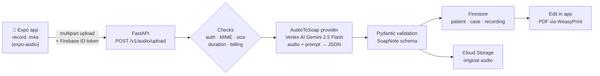

# SoapNotesAi

Voice-to-SOAP-note app for clinicians. A doctor records the patient visit on their phone. One multimodal AI call turns the audio into a verbatim transcript and a structured **SOAP note** (Subjective, Objective, Assessment, Plan). The note is checked against a strict schema, saved to the patient's chart, and can be printed as a PDF on the clinic's letterhead.

Full-stack project: **React Native (Expo) mobile + web app**, a **Python FastAPI backend**, **Firebase** for auth and data, and **Gemini 2.5 on Vertex AI** for the AI. The backend runs on Google Cloud Run.

> Built with synthetic test data only. Generated notes are drafts that a licensed clinician must review. See [Disclaimer](#disclaimer).

## Highlights

- **Audio to chart in one call.** Gemini 2.5 takes the raw recording and returns the transcript and the structured note together, so there is no separate speech-to-text step.
- **Multilingual dictation.** Handles English, Hindi, Telugu, Kannada and mid-sentence code-switching. The transcript stays in the spoken language and script; the SOAP note is always written in clinical English.
- **Safety guardrails.** The prompt forbids invented vitals, diagnoses or doses. Output is forced to JSON, run at low temperature and validated with Pydantic before anything is saved.
- **Multi-tenant.** Organizations → clinics → patients → cases. Every request is scoped by a verified Firebase ID token, and Firestore/Storage rules enforce the same boundary.
- **Production features.** Clinic letterhead PDFs, follow-up cases, patient reminders with push notifications, phone OTP sign-in, staff invites, doctor verification, per-clinic billing with Razorpay, and per-note AI cost tracking.
- **Tested and deployed.** 63 backend tests (pytest), Docker image on Cloud Run, Expo web build on Firebase Hosting.

## How the audio becomes a SOAP note



1. **Record.** The mobile app records high-quality AAC (`.m4a`) audio with `expo-audio`. The doctor can pick an existing patient and case, or start a new patient.
2. **Upload and gate.** The app sends the audio as multipart form data with a Firebase ID token. The backend verifies the token, checks the file type (m4a/mp4/wav/mp3/webm), size and duration, and reserves a note slot in the clinic's billing plan *before* calling the AI, so a refused request costs nothing.
3. **One multimodal call.** The `AudioToSoap` provider sends the audio bytes plus a clinical-scribe prompt to **Gemini 2.5 Flash on Vertex AI** (`response_mime_type="application/json"`, `temperature=0.1`). The model returns one JSON object:
   - `transcript`: verbatim, in the language(s) spoken
   - `language`: `en`, `hi`, `te`, `kn` or `mixed`
   - `soap`: patient demographics, Subjective (chief complaint, HPI, symptoms, history, medications, allergies), Objective (vitals, exam, findings, labs), Assessment (impressions, diagnoses) and Plan (medications, tests, procedures, follow-up, education, referrals)

   The prompt maps everyday complaints to clinical terms (for example *"chakkar aana"* → dizziness), converts spoken numbers to digits, and leaves any field empty when it was not said.
4. **Validate.** The JSON is parsed and checked against the `SoapNote` Pydantic model. Known failures map to stable error codes (`invalid_json`, `schema_validation_failed`, `content_blocked`, `quota_exceeded`, …). Logs record field paths only, never patient text. On failure the billing slot is released.
5. **File it in the chart.** If no patient was picked, one is created from the name, age and sex the AI extracted. A new case is titled from the chief complaint; a follow-up recording joins its open case. The audio goes to Cloud Storage and the transcript and note go to Firestore under `organizations/{org}/clinics/{clinic}/patients/{patient}/…`. Token usage is stored to track AI cost per note.
6. **Review and print.** The doctor edits the note in the app. The backend renders a PDF with WeasyPrint: the first visit on clinic letterhead, follow-ups on continuation sheets.

The AI step sits behind a Python `Protocol` (`backend/app/interfaces/audio_to_soap.py`). Swapping in another model, or splitting it back into separate speech-to-text and LLM steps, means adding one provider class. A `fake` provider makes the full pipeline testable without cloud calls.

## Tech stack

| Layer | Technology |
|---|---|
| Mobile / web | React Native 0.81, Expo SDK 54, Expo Router, TypeScript |
| Backend | Python 3.12, FastAPI, Pydantic v2, `uv` |
| AI | Gemini 2.5 Flash (multimodal) on Vertex AI |
| Auth | Firebase Authentication (email, Google, phone OTP) |
| Data | Cloud Firestore, Cloud Storage for Firebase |
| PDF | WeasyPrint (HTML/CSS template → PDF) |
| Payments | Razorpay |
| Infra | Docker, Google Cloud Run, Artifact Registry, Firebase Hosting |
| Testing | pytest |

## Repository layout

```
backend/    FastAPI app: routers, Pydantic models, AI provider interfaces, services, tests
mobile/     Expo app: record, patients and profile tabs, auth, payments, typed API client
firebase/   Firestore and Storage security rules, indexes
deploy/     Dockerfile and Cloud Run deploy scripts
docs/       Architecture, compliance notes, deployment runbook, roadmap
```

## Run it locally

You need Python 3.12+, [`uv`](https://docs.astral.sh/uv/), Node 20+, and a Firebase project with Firestore, Storage and Authentication turned on. For real AI output you also need a Google Cloud project with Vertex AI enabled; otherwise set `AUDIO_TO_SOAP_PROVIDER=fake`.

**Backend**

```bash
cd backend
cp .env.example .env        # fill in your own project IDs
uv sync
uv run uvicorn app.main:app --reload --port 8000
```

The backend uses Application Default Credentials (`gcloud auth application-default login`), so no key file is needed for local development.

**Mobile**

```bash
cd mobile
cp .env.example .env        # your Firebase web config + backend URL
npm install
npx expo start
```

Press `i` for the iOS simulator, `a` for Android, or `w` for the web build.

**Tests**

```bash
cd backend
uv run pytest
```

**Security rules**

```bash
cd firebase
firebase deploy --only firestore:rules,storage
```

Deployment to Cloud Run is described in [`docs/DEPLOYMENT.md`](docs/DEPLOYMENT.md).

## Security and privacy

- No secrets are committed. Configuration comes from environment variables; see the two `.env.example` files.
- The backend never trusts the client for organization, clinic or user IDs. It reads them from the verified ID token.
- Errors and logs never contain patient data.
- Going live with real patient data needs a Google Cloud BAA and a review of HIPAA-eligible services. [`docs/compliance-notes.md`](docs/compliance-notes.md) lists every place patient data leaves the system.

## Disclaimer

Generated SOAP notes are a draft assistive tool. A licensed clinician must review, correct and sign them before any clinical use. This software is not a substitute for professional medical judgment.
